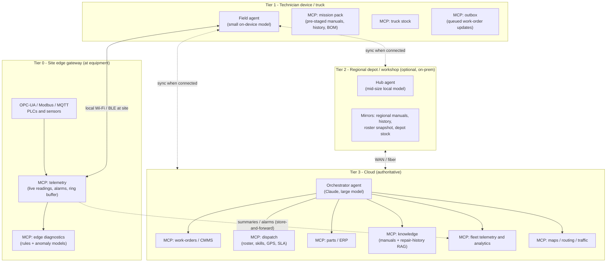
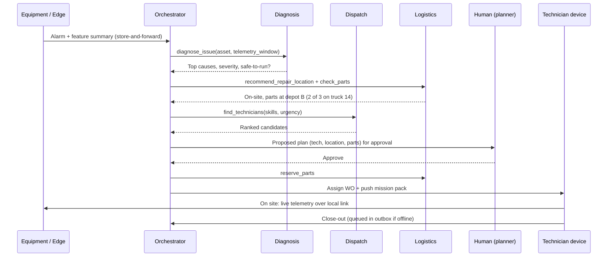
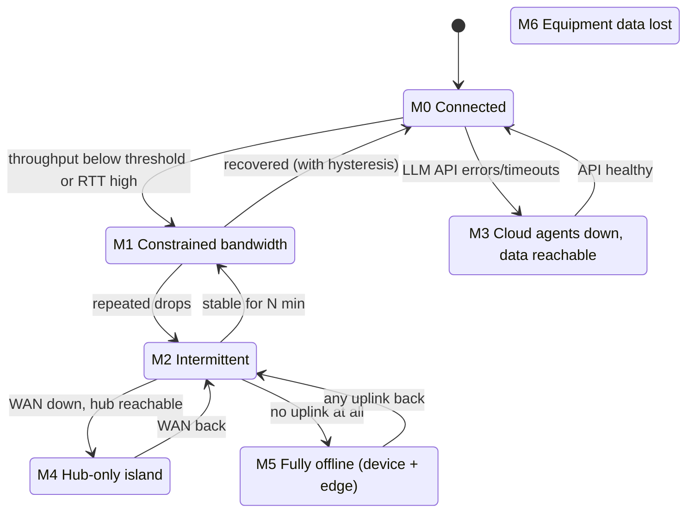

# hybrid-ai: Field Service Agent Design

**Status:** Draft v0.1 · 2026-11-08
**Scope:** An MCP-based agent system that helps maintain a large fleet of industrial equipment spread across California, and keeps working when the network is intermittent, slow, or the cloud is gone.

---

## 1. Problem and goals

For every equipment issue, the maintainer runs the same decision chain:

| # | Workflow | Question it answers |
|---|----------|--------------------|
| W1 | **Triage and diagnosis** | What is wrong, how bad is it, is it safe to keep running? |
| W2 | **Technician allocation** | Who is qualified, close, available, and certified for this asset? |
| W3 | **Repair location** | Fix it on site, or pull it to a workshop/depot? |
| W4 | **Parts availability** | Are the parts on the truck, at a depot, or do they need ordering? Reserve them. |
| W5 | **Execution support** | Step-by-step procedure, manuals, past fixes, safety (LOTO) checklist at the asset. |
| W6 | **Close-out and learning** | Record what was done so future triage gets better. |

**Constraints that drive the design:**

- **Connectivity varies a lot.** Central Valley farms, desert solar/wind sites, Sierra foothills and oil fields have cellular dead zones. PSPS (wildfire power shutoffs) can take out site power and towers for days.
- **Equipment data is real-time and large.** Vibration, temperature, pressure and PLC alarms can't all be streamed raw over a weak link.
- **Knowledge is heavy.** Service manuals (PDFs, schematics) and years of repair history are gigabytes. They can't be fetched on demand from a remote site.
- **Decisions have safety and cost consequences.** A human approves dispatch, shutdown and part orders, and the system must never act on stale data without saying so.

**Design goal:** *Every workflow has a cloud-best answer and a local-good-enough answer, behind the same interface.*

---

## 2. Architecture overview

Four tiers. Each tier runs **the same MCP tool contracts** with different depth of data and intelligence. A **router** on each node decides which tier answers each call, based on the current connectivity mode (§5).



### 2.1 Tier responsibilities

| Tier | Runs on | Agent / model | Holds | Authoritative for |
|------|---------|---------------|-------|-------------------|
| **T0 Edge** | Industrial gateway per site (fanless PC or ARM box, battery/UPS backed) | No LLM. Deterministic rules plus small anomaly/ML models | Live telemetry, 7–30 day ring buffer, alarm log, asset nameplate | Live equipment state |
| **T1 Field** | Rugged tablet/laptop in truck | Small local LLM (via llama.cpp / Ollama class runtime) | Mission packs, truck inventory, offline outbox | Truck stock, on-site observations |
| **T2 Hub** | Server at each regional depot/workshop | Mid-size local LLM | Regional mirror of manuals, history, roster snapshot, depot stock | Depot/workshop stock and bay schedule |
| **T3 Cloud** | Cloud | Claude orchestrator (e.g. `claude-opus-5-5` for planning, `claude-haiku-5-5` for high-volume triage) | Everything: CMMS, ERP, full KB, fleet analytics | Work orders, assignments, reservations, purchase orders |

### 2.2 The key idea: one MCP contract, many implementations

Every capability is exposed as an MCP server with **the same tool names and schemas at every tier**. Only the backing data and its freshness differ.

```
diagnose_issue(asset_id, symptoms?, telemetry_window?) -> Diagnosis
find_technicians(asset_id, skill_tags, urgency)        -> [Candidate]
recommend_repair_location(asset_id, diagnosis)         -> LocationDecision
check_parts(part_numbers | diagnosis, near=location)   -> [PartAvailability]
reserve_parts(part_numbers, work_order_id)             -> Reservation
search_knowledge(asset_model, query)                   -> [ManualSection | PastRepair]
get_live_telemetry(asset_id, signals, window)          -> TelemetrySlice
update_work_order(work_order_id, patch, idempotency_key)-> WorkOrder
```

**Every response carries provenance**, so agents and humans always know what they are looking at:

```json
{
  "result": { "...": "..." },
  "source_tier": "field",
  "as_of": "2026-11-08T14:02:11Z",
  "staleness_s": 18240,
  "confidence": "provisional",
  "authoritative": false
}
```

Agents are prompted to **always surface `as_of` and `confidence`** to the technician (e.g. *"Roster is 5 h old; assignment is provisional until sync."*).

### 2.3 MCP router (on every node)

A small local service that agents connect to as their single MCP endpoint. For each tool call it:

1. Checks the current **connectivity mode** (§5) and per-tier health.
2. Tries tiers in policy order (for example cloud → hub → local for `find_technicians`, or local → cloud for `get_live_telemetry`).
3. Applies a **deadline budget** (for example 3 s on a slow link) and falls back on timeout.
4. Turns writes into **outbox events** when the authoritative tier can't be reached.
5. Labels the response with provenance.

This keeps agents simple: they call `check_parts` and the router decides where the answer comes from.

---

## 3. Agents

| Agent | Tier(s) | Role |
|-------|---------|------|
| **Orchestrator** | Cloud (fallback: hub) | Owns a work order end to end. Plans W1–W6, calls specialists, asks the human for approvals. |
| **Diagnosis agent** | Cloud / hub / field | Correlates telemetry, alarms, symptoms, manuals and similar past repairs, then ranks probable causes and gives a safety verdict. |
| **Dispatch agent** | Cloud (fallback: hub rules) | Scores technicians on skills, certifications, distance/drive time, workload, SLA and overtime. |
| **Logistics agent** | Cloud / hub | Decides repair location, checks parts across truck → depot → warehouse → vendor, and reserves them. |
| **Field assistant** | Field device | Talks with the technician at the asset: procedures, LOTO checklist, live readings, captures findings. Works fully offline. |
| **Sync agent** (non-LLM service) | Every node | Mission-pack prefetch, outbox replay, conflict resolution. |

Specialists are invoked as tools/sub-agents by the orchestrator. Offline, the field assistant runs a **reduced version** of the same chain locally.

---

## 4. Workflow design (with fallbacks built in)

### 4.1 End-to-end flow



### 4.2 Per-workflow logic and degradation

**W1 Triage and diagnosis**
- *Full:* Cloud model combines telemetry features, alarm codes, symptom text, RAG over manuals and fleet-wide repair history, and failure rates from similar assets.
- *Degraded:* Edge diagnostics (alarm-code lookup tables, threshold and trend rules, anomaly score) plus the field LLM over the mission pack's manuals and the asset's own history.
- *Safety rule:* Any rule-based **"unsafe to run"** verdict from the edge wins over model output at every tier, and no agent can override it.

**W2 Technician allocation**
- *Full:* Optimizer over live roster, GPS, certifications (for example high-voltage or confined-space), current jobs, drive time from the routing API, and SLA.
- *Degraded:* Hub uses the last roster snapshot with a rule-based score (skill match → region → last known location).
- *Offline:* Field agent can only suggest "self" or "call dispatcher". It drafts an SMS/voice script for the human.
- Every assignment made without the cloud is **provisional** and confirmed or bumped on sync.

**W3 Repair location (on-site vs workshop)**
A transparent scoring rule (explainable, works at every tier). The cloud can refine it with a learned model.

| Factor | Favors on-site | Favors workshop |
|--------|---------------|-----------------|
| Repair complexity / estimated hours | Low | High, or needs a bench/test rig |
| Asset portability | Fixed/large | Skid-mounted or portable |
| Special tools / clean environment | Not needed | Needed |
| Downtime cost | High (keep it close) | Tolerable |
| Site conditions (heat, fire risk, access) | OK | Poor |
| Parts staging | Parts can reach site | Parts are at workshop |

**W4 Parts availability**
- Search order: **truck → nearby trucks → depot → central warehouse → vendor**.
- *Full:* Live ERP plus a **hard reservation** with an expiry.
- *Degraded:* Hub knows depot stock live and other stock from a snapshot. It makes a **soft reservation**.
- *Offline:* Truck stock only. Consumed parts are logged to the outbox and reconciled on sync.
- *Conflict rule:* The cloud is authoritative. If two offline soft reservations collide, the earlier work order with higher priority wins, and the loser gets an alternative-source proposal.

**W5 Execution support**
- Fully local by design. The mission pack holds procedures, exploded diagrams, torque specs, LOTO steps and past fixes for this asset model.
- Live readings come straight from the edge gateway over site Wi-Fi/BLE, with no WAN needed.

**W6 Close-out and learning**
- Structured findings (cause code, parts used, hours, photos) are written to the outbox and synced to CMMS, then indexed into the repair-history KB.
- Photos/video upload last, on good links only (see the bandwidth classes in §6).

---

## 5. Hybrid operating modes

A **link monitor** on every node measures cloud reachability, round-trip time, throughput, and cloud-agent (LLM API) health. A small state machine picks the mode, and the router policy changes with it.



M6 (lost sensors or edge gateway) can happen **in any of these modes**. It is a separate, data-side flag.

### 5.1 What each mode means for each workflow

| Mode | Trigger | W1 Diagnosis | W2 Technician | W3 Location | W4 Parts | W5 Execution | W6 Close-out |
|------|---------|--------------|---------------|-------------|----------|--------------|--------------|
| **M0 Connected** | Normal | Cloud model, full fleet RAG | Live optimizer | Learned + rule score | Live ERP, hard reserve | Mission pack + cloud KB | Real-time sync |
| **M1 Constrained** (for example <256 kbps, high latency, satellite) | Throughput/RTT thresholds | Cloud model, **compact context** (edge features only, no raw waveforms) | Live optimizer (small payloads) | Same as M0 | Live ERP | Mission pack only, no large fetches | Text now, media deferred |
| **M2 Intermittent** | Repeated drops | Local first, cloud second opinion when the link blips | Cloud if reachable inside the deadline, else hub snapshot (provisional) | Rule score locally | Soft reserve, confirmed on sync | Local | Outbox, replay on reconnect |
| **M3 Cloud agents down** (LLM API outage, quota, region issue) | LLM health checks fail, data APIs OK | **Hub/field model** reasoning over live cloud data via MCP | Deterministic optimizer (no LLM needed) | Rule score | Live ERP (data still up) | Local | Real-time sync |
| **M4 Hub-only island** (WAN down, depot LAN up) | Cloud unreachable, hub reachable | Hub model + regional KB | Hub snapshot + rules (provisional) | Rule score | Depot live, others from snapshot | Local | Queued at hub |
| **M5 Fully offline** (remote site, PSPS) | No uplink | Edge rules + field model + mission pack | "Self", or human calls dispatch | Rule score; technician decides | **Truck stock only** | Fully local | Outbox on device |
| **M6 Equipment data lost** (sensor/gateway down) | Telemetry stale | Symptom-driven: guided inspection Q&A, history of similar faults | Unchanged | Bias toward on-site inspection first | Unchanged | Manual readings captured on device | Flag the sensor fault as its own WO |

### 5.2 Guaranteed minimum capability (the "floor")

Even in **M5 + M6** (no network, no sensors), a technician standing at the asset can still:

- Open the asset's manuals, procedures, LOTO checklist and past repairs (mission pack).
- Get guided diagnosis from the on-device model over that pack.
- See and decrement truck stock.
- Record findings, parts used and photos, which sync later with no data loss.

---

## 6. Data and bandwidth strategy

### 6.1 Mission packs (the most important offline mechanism)

When a WO is assigned, or nightly for each technician's territory, the sync agent pre-stages to the device:

- Manual sections for the **asset model** (pre-chunked, with a local vector index).
- Last N repairs on **this asset** and the top-K similar repairs fleet-wide.
- BOM and likely parts for the top diagnosis candidates.
- Recent telemetry summary and alarm history.
- Site info: access notes, hazards, gate codes (encrypted at rest).

**Territory baseline packs** cover every asset model in a technician's region, refreshed when they are on depot Wi-Fi, so even unplanned call-outs work offline.

### 6.2 Telemetry at the edge

- Raw high-rate data stays at the edge in a ring buffer.
- The edge sends **features** (RMS, peaks, FFT bands, trends, anomaly scores) and **alarms**, not waveforms.
- On request (M0/M1 only), a bounded raw window can be uploaded for deep analysis.

### 6.3 Traffic priority classes

| Class | Examples | Allowed in |
|-------|----------|-----------|
| P0 Safety | Trip/unsafe alarms, LOTO confirmations | All modes; uses any link incl. SMS/satellite |
| P1 Control | WO assignments, reservations, status changes | M0–M2 |
| P2 Context | Diagnosis requests, telemetry features | M0–M2 (compact in M1/M2) |
| P3 Knowledge | Mission pack deltas, history | M0, M1 off-peak |
| P4 Bulk | Photos, video, raw waveforms, full manuals | M0 only, ideally depot Wi-Fi |

### 6.4 Sync and conflicts

- **Event-sourced outbox/inbox** on each node (SQLite). Every write has an **idempotency key** so replays never double-apply.
- **Ownership rules** instead of generic merges:
  - Cloud owns: WO assignment, reservations, purchase orders.
  - Edge owns: telemetry and alarms.
  - Device owns: on-site observations, parts consumed from truck.
- Offline decisions are stored as **proposals** (`provisional: true`). The cloud confirms them or returns a counter-proposal, and the technician is notified.
- Append-only data (findings, readings, photos) never conflicts.

---

## 7. Safety, approval and trust

- **Human-in-the-loop gates:** dispatch, shutdown recommendations, part orders above a cost threshold, and any change to equipment setpoints. Agents propose, humans approve.
- **Read-only to equipment by default.** The telemetry MCP server exposes no write/control tools. Control actions, if ever added, go through the existing PLC/SCADA safety layer.
- **Staleness guardrails:** tools refuse or warn when data is older than a per-tool threshold (for example live telemetry older than 5 min is never shown as "live").
- **Audit log** of every agent decision, the data versions it used, and the approver.
- **Security:** mTLS between tiers, device encryption at rest, per-technician scoped tokens, and remote wipe for lost tablets.

---

## 8. Suggested technology stack

| Concern | Choice (initial) |
|---------|-----------------|
| MCP servers | Python with the official MCP SDK (same codebase deployed per tier, with a backend adapter per tier) |
| Edge protocols | OPC-UA, Modbus TCP, MQTT (Mosquitto at edge) |
| Local storage | SQLite (outbox, caches) + sqlite-vec or LanceDB for local vector search |
| Cloud storage | Postgres + object storage; existing CMMS/ERP via adapter MCP servers |
| Local models | Small open model on device, mid-size on hub (llama.cpp / Ollama class runtime) |
| Cloud models | Claude (`claude-opus-5-5` orchestrator, `claude-haiku-5-5` triage/summarization) |
| Links | Cellular primary, satellite backup (P0–P1 only), depot Wi-Fi for bulk |
| Edge hardware | Fanless gateway rated for heat, with UPS/battery for PSPS events |

---

## 9. Proposed repository layout

```
hybrid-ai/
├── docs/DESIGN.md
├── src/hybrid_ai/
│   ├── contracts/        # MCP tool schemas (tools.json) + validation/envelope helpers  [phase 1 done]
│   ├── sim/              # fleet, telemetry and network-mode simulators (M0–M6)          [phase 1 done]
│   ├── router/           # MCP router + link monitor + mode state machine
│   ├── servers/          # telemetry, diagnostics, knowledge, dispatch, parts, workorders
│   ├── agents/           # orchestrator, diagnosis, dispatch, logistics, field assistant
│   └── sync/             # outbox/inbox, mission-pack builder, conflict rules
└── tests/
```

---

## 10. Phased roadmap

1. **Contracts and simulator.** Define the MCP tool schemas. Build a fake fleet (assets, techs, parts, manuals) and a network fault injector for M0–M6.
2. **Single-tier MVP (cloud, M0).** Orchestrator plus specialists running W1–W4 end to end against simulated data, with human approval.
3. **Field tier and mission packs.** Offline field assistant (W5/W6), outbox sync, provisional decisions. Test M2 and M5.
4. **Router and modes.** Link monitor, tier fallback, deadline budgets, provenance labels. Test M1 and M3.
5. **Edge integration.** A real gateway on one pilot site, telemetry features, edge safety rules. Test M6.
6. **Hub tier (optional).** Regional depot mirror for M4, rolled out where a depot has a solid LAN.
7. **Pilot, then scale.** One region (for example the Central Valley), measure, then expand.

### Success metrics
Mean time to diagnose, first-time fix rate, technician drive time per WO, parts-not-available rate, % of WOs completed in degraded modes without data loss.

---

## 11. Open questions

1. Which CMMS/ERP systems are in use today (for example Maximo, SAP PM, Fiix, UpKeep)? This decides the adapter MCP servers.
2. What equipment classes and protocols are involved, and do assets already have gateways/SCADA?
3. Roughly how many assets, sites, technicians and depots?
4. Does a regional depot/workshop network exist (needed for the T2 hub)?
5. What are the approval rules today (who approves dispatch, shutdowns, purchases)?
6. Are there data-residency or customer contracts limiting what telemetry can go to the cloud?
