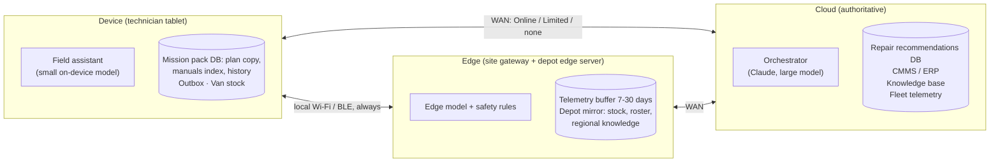
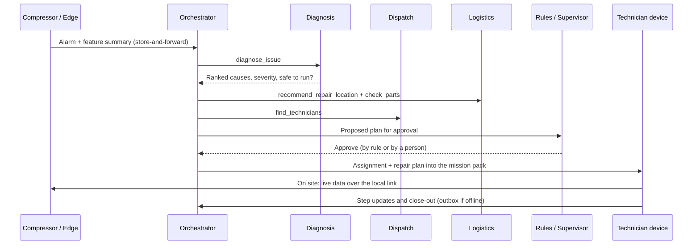
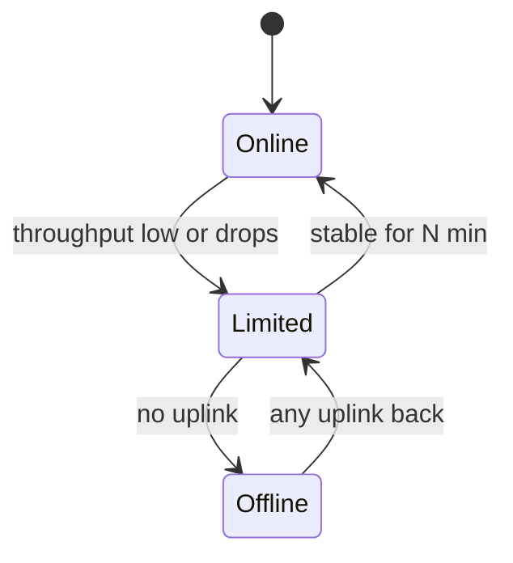

# hybrid-ai: Field Service Agent Design

**Status:** Draft v0.6 · 2026-11-09 (three modes, three places, repair recommendation model, live multi-process demo; demo scope in §11). Implementation details: [TECHNICAL.md](TECHNICAL.md).
**Scope:** MCP-based agents that help maintain a fleet of industrial compressors spread across California, and keep working when the network is slow, intermittent or gone.

---

## 1. Problem and goals

For every compressor issue, the maintainer runs the same decision chain:

| # | Workflow | Question it answers |
|---|----------|--------------------|
| W1 | **Triage and diagnosis** | What is wrong, how bad is it, is it safe to keep running? |
| W2 | **Technician allocation** | Who is qualified, close, available and certified for this compressor? |
| W3 | **Repair location** | Fix it on site, or pull it to a workshop? |
| W4 | **Parts availability** | Are the parts in the van, at a depot, or do they need ordering? Reserve them. |
| W5 | **Execution support** | Step-by-step repair plan, manuals, past fixes and lockout/tagout (LOTO) at the compressor. |
| W6 | **Close-out and learning** | Record what was done so future triage gets better. |

**Constraints that drive the design:**

- **Connectivity varies a lot.** Central Valley farms, desert sites, foothills and oil fields have cellular dead zones. Wildfire power shutoffs (PSPS) can take out site power and towers for days.
- **Equipment data is real-time and large.** Vibration, temperature, pressure and controller alarms can't all be streamed raw over a weak link.
- **Knowledge is heavy.** Manuals and years of repair history are gigabytes and can't be fetched on demand from a remote site.
- **Decisions have safety and cost consequences.** Rules or a person approve dispatch, shutdowns and part orders. Nothing should act on stale data without saying so.

**Design goal:** *every workflow has a cloud-best answer and a local good-enough answer, behind the same interface.*

---

## 2. Architecture: three places

Agents and data live in three places. Each runs **the same MCP tool contracts** with different depth of data and intelligence. A **router** on each node decides where each call runs, based on the current mode (§5).



| Place | Runs on | Models | Databases | Authoritative for |
|------|---------|--------|-----------|-------------------|
| **Cloud** | Cloud | Claude: `claude-opus-5-5` for diagnosis and planning, `claude-haiku-5-5` for short answers | Repair recommendations DB, model registry, CMMS/ERP, knowledge base, fleet telemetry store | Work orders, assignments, reservations, repair plans, model versions |
| **Edge** | Site gateway at the compressor, plus the depot's edge server | Repair recommendation model copy; mid-size local LLM; deterministic safety rules | Telemetry buffer (7–30 days), safety rules, depot mirror (stock, roster snapshot, regional knowledge) | Live equipment state and alarms; depot stock |
| **Device** | Technician's rugged tablet in the service van | Repair recommendation model copy; small on-device LLM | Mission pack DB (repair plan copy, manuals index, history), outbox, van stock | On-site observations, parts used from the van |

### 2.1 One MCP contract, many implementations

Every capability is an MCP server with **the same tool names and schemas in every place**. Only the backing data and its freshness differ.

```
diagnose_issue(asset_id, symptoms?, telemetry_window?) -> Diagnosis
find_technicians(asset_id, skill_tags, urgency)        -> [Candidate]
recommend_repair_location(asset_id, cause_code)        -> LocationDecision
check_parts(part_numbers | cause_code, near?)          -> [PartAvailability]
reserve_parts(work_order_id, items, idempotency_key)   -> Reservation
search_knowledge(asset_model, query)                   -> [ManualSection | PastRepair]
get_live_telemetry(asset_id, signals?, window)         -> TelemetrySlice
update_work_order(work_order_id, patch, idempotency_key)-> WorkOrder
```

**Every response carries provenance**, so agents and people always know what they are looking at:

```json
{
  "result": { "...": "..." },
  "source_tier": "device",
  "as_of": "2026-11-08T14:02:11Z",
  "staleness_s": 18240,
  "confidence": "provisional",
  "authoritative": false
}
```

Agents always tell the technician when data is provisional or old (for example *"Roster is 5 h old; assignment is provisional until sync."*).

### 2.2 The router

A small local service that agents use as their single MCP endpoint. For each call it:

1. Checks the current **mode** and events (§5).
2. Tries places in the tool's policy order, for example cloud → edge → device for `diagnose_issue`, or edge first for `get_live_telemetry`.
3. Applies a **deadline** (for example 3 s on a Limited link) and falls back on timeout.
4. Turns writes into **outbox events** when the cloud can't be reached.
5. Labels the response with provenance, and logs where it ran, why, and its cost in time and tokens.

Agents stay simple: they call `check_parts` and the router decides where the answer comes from. **Work therefore moves:** the repair recommendation model runs from the cloud copy when Online, from the edge copy next to the compressor's data when the link is Limited or gone, and from the device copy when the edge is dark too; the LLM that explains the answer moves the same way (Claude → edge model → device model).

---

## 3. Agents

| Agent | Usually runs | Moves to | Role |
|-------|--------------|----------|------|
| **Orchestrator** | Cloud | Device (reduced) when offline | Owns a work order end to end; plans W1–W6; asks for approvals. |
| **Repair recommendation model** (trained ML model, not an agent) | Cloud | Edge (Limited, Offline) → Device (sensors lost) | Ranks causes from telemetry, symptoms and history priors (§4.3). Same weights everywhere, no tokens; a cloud AI outage doesn't affect it. |
| **Dispatch** | Cloud | Edge roster snapshot (Limited); unavailable Offline | Scores technicians on skills, certifications, distance, workload and SLA. Deterministic, so it needs no LLM. |
| **Logistics** | Cloud | Edge depot mirror (Limited) → Device van stock (Offline) | On-site vs workshop; parts from van → depot → warehouse → vendor; reservations. |
| **Field assistant** | Device | (stays on device) | Answers the technician, walks the repair plan and LOTO, captures findings. Uses the best model it can reach. |
| **Safety rules** | Edge | (stays at edge) | Deterministic trip and "unsafe to run" rules next to the sensors. |
| **Sync service** (no LLM) | Everywhere | — | Mission-pack prefetch, outbox replay, conflict rules. |

---

## 4. Workflows

### 4.1 End to end



### 4.2 Repair recommendations

Each work order's plan is stored in the **repair recommendations database**: ranked causes, an ordered step list (lockout → verify → repair → test → close-out), parts and references (manual sections, past repairs on this compressor, similar fixes elsewhere). The assigned technician works through the steps. A copy travels in the mission pack; step updates made offline replay once, keyed by idempotency key.

### 4.3 Repair recommendation model

A small **trained model** (`repair-rec-1.0`), not an LLM, ranks the likely causes for a compressor:

- **Inputs:** each signal's deviation from baseline and its recent trend, reported symptoms, and how often each cause appeared in past repairs (priors).
- **Form:** one multinomial logistic regression per compressor type; classes are that type's failure modes plus "healthy". About 9 KB of JSON weights.
- **Training:** in the cloud, on simulated telemetry and symptoms plus the fleet's repair history. Held-out accuracy: 94.5% top-1, 98.1% top-2 (demo data).
- **Deployment:** the cloud model registry holds the versions; the same file is copied to every edge and into every mission pack. It runs in milliseconds with no network and no tokens, and still works from symptoms alone when sensors are lost.
- **Division of labour:** the model ranks; the planning rules turn the top cause into the stored plan (steps, parts, references); an LLM only explains the result in words. Each plan records the model version and its confidence.

### 4.4 Repair location (W3)

An explainable factor score that works everywhere; the cloud can refine it with a learned model.

| Factor | Favors on site | Favors workshop |
|--------|---------------|-----------------|
| Estimated hours | Low | High, or needs a bench |
| Portability | Fixed (centrifugal) | Skid-mounted or towable |
| Special tools | Not needed | Needed |
| Downtime cost | High | Tolerable |

### 4.5 Parts (W4)

Search order: **van → nearby vans → depot → central warehouse → vendor**. Online: live ERP and hard reservation. Limited: depot mirror at the edge, soft reservation. Offline: van stock only; parts used are logged to the outbox. The cloud is authoritative: if two soft reservations collide, the earlier higher-priority work order wins and the other gets an alternative source.

---

## 5. Three operating modes

A **link monitor** on each node measures cloud reachability, round-trip time and throughput and picks the mode. Recovery uses hysteresis so the mode doesn't flap.



| Mode | What it means | Where agents run | Data |
|------|---------------|------------------|------|
| **Online** | Cloud reachable at normal speed | Cloud for reasoning and decisions; edge for live data and safety; device for the assistant UI | Live; updates sync immediately |
| **Limited** | Slow or intermittent: one bar of LTE, satellite backup, coverage edges | Edge model next to the data for diagnosis; cloud only when a window opens and within deadline; device answers first | Small messages only; P0–P2 sent in windows; media deferred |
| **Offline** | No WAN; device and edge still talk over the local link | Edge model and rules; device model and mission pack; dispatch unavailable | Everything queued in the outbox |

**Two events can happen in any mode:**

| Event | What changes |
|-------|--------------|
| **Cloud AI outage** (model API failing, network fine) | Reasoning moves to the edge model; data, dispatch and the database stay live in the cloud. |
| **Sensors lost** (gateway or sensors dark, e.g. site power cut) | No live data: diagnosis moves to the device as guided inspection; manual readings are recorded. |

### 5.1 Each mode, each workflow

| Workflow | Online | Limited | Offline |
|----------|--------|---------|---------|
| W1 Diagnosis | Repair-rec model, cloud copy | Repair-rec model, edge copy on local telemetry | Edge copy (device copy from symptoms if sensors lost) |
| W2 Technician | Live optimizer | Cloud within deadline, else edge roster snapshot (provisional) | Unavailable: call the dispatcher |
| W3 Location | Learned + rule score | Rule score | Rule score; technician decides |
| W4 Parts | Live ERP, hard reservation | Depot mirror, soft reservation | Van stock only |
| W5 Execution | Repair plan from the DB | Plan from the mission pack | Plan from the mission pack |
| W6 Close-out | Real-time sync | Text in windows, media later | Outbox on the device |

### 5.2 Guaranteed minimum

Even **Offline with sensors lost**, a technician at the compressor can still open the repair plan, manuals, LOTO checklist and past fixes; get guided diagnosis from the device model; see and use van stock; and record findings, parts and photos that sync later without loss.

---

## 6. Data and bandwidth

### 6.1 Mission packs

On assignment, and nightly on depot Wi-Fi, the device receives: the repair plan, manual sections with a local search index, recent and similar repairs, likely parts, a telemetry summary, and site access notes and hazards (encrypted at rest).

### 6.2 Telemetry at the edge

Raw data stays in the edge buffer. The edge sends **features** (RMS, trends, anomaly scores) and **alarms**, not waveforms. Raw windows upload only when Online.

### 6.3 Priority classes

| Class | Examples | Sent in |
|-------|----------|---------|
| P0 Safety | Trip alarms, LOTO confirmations | Online, Limited (first in every window) |
| P1 Control | Assignments, reservations, step updates | Online, Limited |
| P2 Context | Diagnosis requests, telemetry features | Online, Limited (compact) |
| P3 Knowledge | Mission-pack updates | Online |
| P4 Bulk | Photos, video, raw waveforms | Online, ideally depot Wi-Fi |

### 6.4 Sync and conflicts

- **Event-sourced outbox** on each node; every write has an **idempotency key**, so replays never double-apply.
- **Ownership rules:** the cloud owns assignments, reservations and repair plans; the edge owns telemetry and alarms; the device owns on-site observations and parts used from the van.
- Offline decisions are **proposals** (`provisional: true`) that the cloud confirms or counters.
- Append-only data (findings, readings, photos) never conflicts.

---

## 7. Safety, approval and trust

- **Approvals by rule** (§11.1); people approve only what the rules send them.
- **Read-only to equipment.** No control tools; setpoints stay with the controller's own safety layer.
- **Edge safety wins.** An edge "unsafe to run" rule can't be overridden by any agent.
- **Staleness guardrails:** old data is never shown as live.
- **Audit log** of every request: where it ran, why, the data versions it used, time and tokens.
- **Security:** mTLS between places, device encryption at rest, scoped tokens, remote wipe.

---

## 8. Technology

| Concern | Choice (initial) |
|---------|-----------------|
| MCP servers | Python, official MCP SDK (`mcp` 2.3, streamable HTTP); one codebase with a backend adapter per place. Running today in the live demo: cloud and edge MCP servers, device router as MCP client (§12) |
| Edge data | Demo: JSONL telemetry files. Later: OPC-UA, Modbus TCP, MQTT |
| Storage | SQLite on device and edge; SQLite (demo) / Postgres in the cloud for repair recommendations |
| Models | Claude in the cloud; mid-size local model at the edge; small on-device model |
| Links | Cellular primary, satellite backup (Limited), depot Wi-Fi for bulk |
| Edge hardware | Fanless gateway rated for heat, with battery for PSPS events |

---

## 9. Repository layout

```
hybrid-ai/
├── docs/                 # this design, slide decks
├── dashboard/            # demo web app (supervisor, technician, walkthrough)
├── models/               # exported model weights (repair-rec-1.0.json)
├── src/hybrid_ai/
│   ├── contracts/        # MCP tool schemas + provenance envelope
│   ├── sim/              # compressor fleet, telemetry and network-mode simulators
│   ├── models/           # repair recommendation model: training + predict
│   ├── demo/             # demo data, repair recommendations DB, simulated-dashboard server
│   └── live/             # live demo: netsim, cloud, edge, device, launcher (§12)
├── deploy/               # systemd user services + installer
├── tools/                # deck builders
└── tests/
```

---

## 10. Roadmap

1. **Contracts and simulator** (done).
2. **Cloud MVP (Online):** real MCP servers and agents for W1–W4 with rule-based approvals. *(MCP servers running in the live demo; LLM agents not yet.)*
3. **Device:** mission packs, field assistant, outbox; test Limited and Offline. *(Mission pack, outbox and replay running in the live demo.)*
4. **Router and modes:** link monitor, fallbacks, deadlines, provenance. *(Running in the live demo, over a simulated network.)*
5. **Edge:** gateway on one pilot site, edge model, safety rules; test sensors lost.
6. **Pilot, then scale.**

**Success metrics:** time to diagnose, first-time fix rate, drive time per work order, parts-not-available rate, share of work orders completed in Limited/Offline without data loss.

---

## 11. Decisions for the demo

| # | Question | Decision | Effect on the design |
|---|----------|----------|----------------------|
| 1 | CMMS / ERP | **Our own MCP servers are the system of record.** | No commercial adapters; data seeded from the simulator. |
| 2 | Equipment data | **Read from files.** | The edge replays per-compressor JSONL files behind `get_live_telemetry`. |
| 3 | Fleet size | **Under 50** of each. | 6 depots, 12 sites, about 30 compressors, 12 technicians. |
| 4 | Depot network | **Yes.** | Each depot runs an edge server (mirror + mid-size model), part of the Edge place. |
| 5 | Approvals | **Rule-based.** | Declarative rules, evaluated the same everywhere (§11.1). |
| 6 | Data limits | **None.** | Only priority classes limit what goes to the cloud. |
| 7 | Equipment classes | **Industrial compressors only.** | Rotary screw, two-stage reciprocating, centrifugal (4.16 kV motor), portable diesel, oil-free scroll. |
| 8 | Repair recommendations | **Stored in a database.** | SQLite behind the work-orders MCP server; the assigned technician works from it (§4.2). |
| 9 | Operating modes | **Three: Online, Limited, Offline.** | Cloud AI outage and sensors lost are events inside a mode; places are Cloud, Edge and Device. |
| 10 | Cause ranking | **A trained repair recommendation model.** | Replaces the hand-written scoring; same weights in every place (§4.3). |
| 11 | Proving the hybrid behavior | **A live demo with real processes.** | Cloud, edge and device run as separate processes talking MCP through a fault-injecting network proxy (§12); deployable as user services on one machine. |

### 11.1 Approval rules

The first matching rule wins. The same rules run everywhere, so approvals keep working offline.

| Action | Condition | Outcome |
|--------|-----------|---------|
| Shutdown | Edge safety rule fired | **Auto**, supervisor notified |
| Shutdown | Any other case | **Site operator** |
| Dispatch | Routine or soon, skills matched, on shift | **Auto** |
| Dispatch | Urgent, missing skills or overtime | **Supervisor** |
| Reserve parts | Van or depot stock, under $1,000 | **Auto** |
| Reserve / order parts | $1,000 or more, or vendor order | **Regional manager** |
| Send to workshop | Any | **Supervisor** |
| Anything offline | Would otherwise be auto | **Auto, provisional**; confirmed on sync |

---

## 12. Live demo: the design running as real processes

The simulated dashboard shows the behavior; the **live demo** makes it actually happen. Full details are in [TECHNICAL.md](TECHNICAL.md).

- **Four processes on one machine:** cloud (MCP server), edge (MCP server), device (the tablet backend), and a network simulator. The simulator is a TCP proxy that delays, flaps or refuses connections according to the mode.
- **The device detects the mode itself** from health probes (success rate and round-trip time), then routes each call by the policy in §5.1, with deadlines and fallbacks.
- **Offline writes go to a real SQLite outbox** and replay to the cloud's repair recommendations DB when the link returns, safety steps first. Idempotency keys make replays exactly-once.
- **The edge stores and forwards** telemetry features to the cloud and buffers them while the WAN is down.
- **Not yet real:** LLM calls (answers are templated, 0 tokens), physical separation, and industrial protocols (telemetry is replayed from files).

| Measured in one run | Result |
|---|---|
| Online diagnose | cloud, 266 ms |
| Limited diagnose | edge, 67 ms |
| Offline lockout steps | queued on the device |
| Sensors lost diagnose | device, 0.2 ms, symptoms only |
| Back online | 5 queued writes replayed once each; work order completed |

