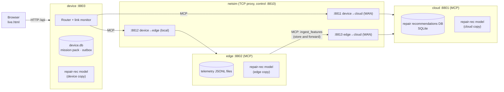

# hybrid-ai: technical description

**Version:** 2026-11-09 · repo `~/hybrid-ai` · companion to [DESIGN.md](DESIGN.md) (the why) and [DEMO.md](DEMO.md) (the 5-minute script).

This document describes what is built: the components, how they run, how they talk, where the data lives, and what is real versus simulated.

---

## 1. Two ways to run it

| | **Live demo** (real processes) | **Simulated dashboard** |
|---|---|---|
| Start | `PYTHONPATH=src .venv/bin/python -m hybrid_ai.live` | `PYTHONPATH=src .venv/bin/python -m hybrid_ai.demo.server --port 8765` |
| Open | http://127.0.0.1:8803/live.html | http://localhost:8765 |
| What runs | 4 processes: cloud, edge, device, network simulator | 1 server + the browser |
| Requests | Real MCP calls between real processes, through a real TCP proxy that delays, flaps and cuts links | Routed inside the browser; network, timings and tokens are modeled |
| Best for | Proving fail-over, outbox replay and mode detection actually work | Telling the story: personas, map, walkthrough, assistant, agents moving |

Both use the same data, the same repair recommendations database code and the same trained model.

---

## 2. Live demo architecture



### 2.1 Processes and ports (all bound to 127.0.0.1)

| Process | Module | Port | Role |
|---|---|---|---|
| netsim | `hybrid_ai.live.netsim` | 8810 control; 8811–8813 routes | TCP proxy; applies the mode to each link |
| cloud | `hybrid_ai.live.cloud` | 8801 (`/mcp`, `/control`) | Authoritative MCP server |
| edge | `hybrid_ai.live.edge` | 8802 (`/mcp`) | MCP server next to the compressor data |
| device | `hybrid_ai.live.device` | 8803 (`/api/*`, static pages) | Tablet backend: router, link monitor, local DBs |
| launcher | `hybrid_ai.live` | — | Starts and stops the four; SIGINT/SIGTERM stop all |

Set `HYBRID_PORT_BASE` to move every port (the tests use 9100); `HYBRID_LIVE_DIR` moves the data directory (default `data/live/`).

### 2.2 Protocols

- **MCP (Model Context Protocol), streamable HTTP, JSON responses, stateless.** Official Python SDK `mcp==2.3.0`: servers are `MCPServer` apps under uvicorn; the device and edge use `mcp.client.client.Client`. Each call is a fresh client session, so a link cut mid-session really fails the next call.
- **Device API (browser ↔ device), JSON over HTTP:** `GET /api/state`, `POST /api/call {tool, args, request}`, `POST /api/net {mode, sensors_lost, cloud_ai_down}`.
- **Operator controls (not routed through netsim):** netsim `POST /state`, cloud `POST /control`. They stand in for a person flipping the network or the cloud AI.

### 2.3 Network simulator (`netsim.py`)

| Mode / event | device→cloud, edge→cloud (WAN) | device→edge (local) |
|---|---|---|
| ONLINE | up, 40 ms per chunk each way | up, 5 ms |
| LIMITED | flaps: up about 55% of the time in 3–9 s windows; 250 ms per chunk | up, 5 ms |
| OFFLINE | connections refused | up, 5 ms |
| sensors lost (event) | edge→cloud refused | **refused** (edge is dark) |

When a route goes down, open connections on it are closed, so in-flight requests fail. Per-route counters (accepted, refused, cut, bytes) are exposed for the live page.

### 2.4 Cloud MCP server (`cloud.py`)

Tools: `health`, `diagnose_issue` (cloud copy of the model on fleet telemetry + symptoms), `find_technicians`, `recommend_repair_location`, `check_parts` (live ERP view), `reserve_parts` (idempotent), `get_repair_plan`, `update_step` (idempotent), `record_outcome`, `explain` (stand-in for the cloud LLM; **fails during a cloud AI outage**), `ingest_features` (from the edge), `status`.
Data: `data/live/cloud-repair-recommendations.db`, rebuilt at start from the simulator.

### 2.5 Edge MCP server (`edge.py`)

Tools: `health`, `get_live_telemetry` (reads `data/live/edge-telemetry/<asset>.jsonl`), `diagnose_issue` (edge copy of the model on those readings), `find_technicians` (roster snapshot, provisional), `check_parts` (depot mirror: van + depot sources only), `explain` (stand-in for the edge LLM), `status`.
Background: every 4 s, summarizes the compressors with open work orders and pushes features to the cloud over edge→cloud. On failure it keeps a buffer (max 200) and sends it when the link returns.

### 2.6 Device backend (`device.py`)

**Link monitor:** every 1.5 s it calls `health` on the cloud and edge through netsim and classifies the mode from real results:

- **ONLINE:** last cloud probe OK, at least 4 of the last 6 OK, last round trip under 1 s
- **LIMITED:** at least one of the last 6 OK
- **OFFLINE:** none OK

The edge is "alive" if its last probe succeeded.

**Router policy** (places tried in order for the detected mode; deadline 3 s for the cloud, 2 s for the edge):

| Tool | ONLINE | LIMITED | OFFLINE |
|---|---|---|---|
| diagnose_issue | cloud → edge → device | edge → device | edge → device |
| get_live_telemetry | edge | edge | edge |
| find_technicians | cloud | cloud → edge | — (call the dispatcher) |
| recommend_repair_location | cloud → device | device | device |
| check_parts | cloud → edge → device | cloud → edge → device | edge → device |
| get_repair_plan | cloud → device | cloud → device | device |
| explain | cloud → edge → device | edge → device | edge → device |
| search_knowledge | device | device | device |

When the edge isn't answering, the edge is skipped for `diagnose_issue` and `explain`.

**Writes** (`update_step`, `record_outcome`, `reserve_parts`): go to the cloud if it can be reached; otherwise into the **outbox** with an idempotency key. Priority: safety steps P0, other writes P1, photos P4.

**Replay:** whenever the cloud answers, the outbox is sent in priority order (P4 only when ONLINE). The cloud database ignores a key it has already applied and reports `duplicate: true`.

**Mission pack:** when the cloud first answers, the assigned repair plan is copied into `data/live/device.db` (table `mission_pack`); offline reads come from it.

**Local tools:** `diagnose_issue` (device copy of the model, symptoms only), `check_parts` (van stock), `get_repair_plan` (mission-pack copy), `recommend_repair_location`, `search_knowledge` (manuals), `explain`.

### 2.7 What the live run shows (measured, one run)

| Step | Where it actually ran |
|---|---|
| Online: diagnose | cloud, 266 ms |
| Limited: diagnose | edge, 67 ms (local first) |
| Limited: who can help | cloud over the slow link, 1.8 s |
| Offline: live readings | edge, 73 ms |
| Offline: lockout steps | device outbox (no WAN) |
| Sensors lost: diagnose | device, 0.2 ms, symptoms only |
| Back online | 5 queued writes replayed to the cloud DB (270–370 ms each); job completed |

---

## 2.8 The AI agent: repair recommendations from the service manuals (RAG)

`hybrid_ai.agents.manual_agent` is the demo's one real AI agent: a tool-use loop on **Claude Opus 5.5** (`claude-opus-5-5`, Anthropic Python SDK 2.6, effort `medium`, server-side refusal fallbacks enabled).

| Tool given to Claude | What it returns |
|---|---|
| `search_service_manual(query, compressor_model?)` | Top 5 passages from the manuals and past repair notes (BM25, `hybrid_ai.rag.index`, 117 passages) |
| `get_work_order(work_order_id)` | Compressor, site hazards, reported symptoms, recent alarms, the repair-rec model's ranked causes, planned parts |
| `get_repair_history(asset_id)` | Past repairs on that compressor |

The system prompt requires a citation (`[doc_id]`) for every step and only retrieved part numbers. The answer comes back with its citations (checked against the index), the tool-call trace, and token usage.

**Where it runs (MCP tool `recommend_repair`):**

| Place | Behavior |
|---|---|
| Cloud | The Claude agent. Fails fast when no credentials are set, `HYBRID_LLM=off`, or during a cloud AI outage, so the router falls back. The router allows it 120 s. |
| Edge | Retrieval only from the edge's copy of the manuals (no LLM at the edge in this demo) |
| Device | Retrieval only from the mission pack |

Router order: Online cloud → edge → device; Limited and Offline edge → device.

**Credentials:** `ANTHROPIC_API_KEY` in the environment, or `/etc/default/hybrid-ai` on a server, or `~/.config/hybrid-ai/env` for the user service. Without credentials, everything still works, retrieval only.

**CLI:** `PYTHONPATH=src .venv/bin/python -m hybrid_ai.agents.manual_agent WO-2026-0001 "question"`.

**Tests:** `tests/test_manual_agent.py` checks retrieval (all 18 faults found from their symptoms) and the agent loop against a scripted stand-in for the API (tool calls, results returned in one turn, tool errors returned to Claude, citations validated, refusal handled). The live test runs with `HYBRID_LLM=off`, so tests never spend tokens. **A real Claude call has not been tested in this repo yet:** it needs a key.

## 3. Shared components

### 3.1 Data and simulator (`hybrid_ai.sim`)

A deterministic California fleet: 6 depots, 12 sites, 30 compressors of 5 types, 12 technicians with vans, stock, repair history, manuals and work orders. Telemetry is synthetic, with faults that drift in. The network simulator for the simulated dashboard is `sim/network.py` (3 modes plus 2 events, named scenarios).

### 3.2 MCP tool contracts (`hybrid_ai.contracts`)

`tools.json` holds JSON Schemas for the 8 core tools and the provenance envelope (`source_tier` ∈ device/edge/cloud, `as_of`, `staleness_s`, `confidence`, `authoritative`). The live servers' tools follow the same names; their arguments are simplified to work-order IDs for the demo.

### 3.3 Repair recommendation model (`hybrid_ai.models`)

Multinomial logistic regression, one per compressor type. Inputs: each signal's deviation from baseline and its trend, symptoms, and priors from repair history. Weights are in `models/repair-rec-1.0.json` (9 KB). Held-out accuracy on simulated data: 94.5% top-1, 98.1% top-2. The same weights run in Python (cloud, edge, device) and in JavaScript (`dashboard/app.js`, `rmPredict`).

### 3.4 Repair recommendations database (`hybrid_ai.demo.repair_db`)

SQLite tables: `recommendations` (one per work order, with model version and confidence), `recommendation_causes`, `repair_steps` (safety → verify → repair → test → closeout), `recommended_parts`, `knowledge_refs`, `step_events` (unique idempotency keys), `repair_outcomes`.

---

## 4. Real vs simulated

| Real | Simulated |
|---|---|
| Four separate processes talking MCP over TCP | Physical separation: all four run on one machine |
| Network faults: refused, delayed and cut connections | WAN characteristics are approximations (fixed latency, random flapping) |
| Mode detection from probe results | — |
| Router fail-over with deadlines | — |
| SQLite outbox and mission pack; idempotent replay | Photo upload (no media store) |
| Repair DB writes and duplicate detection | Parts reservations are held in memory in the cloud process |
| Repair-rec model inference in every place | Training data is simulated |
| | **LLM calls: none.** `explain` returns templated text from whichever place answers; token counts are 0 in the live demo and modeled in the simulated dashboard |
| | Telemetry: replayed from files, not from OPC-UA/Modbus |

---

## 5. Tests

```bash
PYTHONPATH=src python3 -m unittest discover -s tests          # 75 tests, no MCP SDK needed (live tests skip)
PYTHONPATH=src .venv/bin/python -m unittest discover -s tests # 77 tests, including the live stack
```

`tests/test_live.py` starts the four real processes on ports 9100+ and checks:

- Online → the cloud answers.
- Offline → the edge answers, dispatch fails, writes queue.
- Sensors lost → the device answers from symptoms.
- Back online → the outbox drains and a replayed key is a duplicate.
- Cloud AI outage → `explain` moves to the edge while the trained model stays in the cloud.

---

## 6. Deploy on this machine

`deploy/` contains two systemd **user** services and an installer:

| Service | Runs | URL |
|---|---|---|
| `hybrid-ai-live` | `python -m hybrid_ai.live` (4 processes) | http://127.0.0.1:8803/live.html |
| `hybrid-ai-dashboard` | `python -m hybrid_ai.demo.server --port 8765 --reset` | http://localhost:8765 |

```bash
~/hybrid-ai/deploy/install.sh            # install or update, enable and start both
~/hybrid-ai/deploy/install.sh --remove   # stop, disable and remove
systemctl --user status hybrid-ai-live hybrid-ai-dashboard
journalctl --user -u hybrid-ai-live -f
```

The services bind to localhost only, restart on failure and start when you log in. To keep them running while logged out: `loginctl enable-linger $USER`. Python dependencies are pinned in `deploy/requirements.txt` and installed into `~/hybrid-ai/.venv`.

---

### 6.1 Ubuntu server

`tools/make_release.sh` builds `dist/hybrid-ai-<date>-<commit>.tar.gz` from the latest commit. On the server, `sudo ./deploy/server/install.sh` installs into `/opt/hybrid-ai` as system services running as a `hybridai` user, with systemd hardening (read-only system, writable `data/` only). The web pages listen on `HYBRID_BIND` (default 127.0.0.1, set in `/etc/default/hybrid-ai`); internal ports always stay on localhost. Step by step: [DEPLOY.md](../DEPLOY.md).

## 7. Repository map

```
dashboard/        index.html + app.js (simulated dashboard), live.html + live.js (live demo), data.js (generated)
deploy/           systemd user units, installer, pinned requirements
docs/             DESIGN.md, TECHNICAL.md, DEMO.md, decks, animated slide + GIF
models/           repair-rec-1.0.json (trained weights)
src/hybrid_ai/
  contracts/      MCP tool schemas + provenance envelope
  sim/            fleet, telemetry, network-mode simulator
  models/         repair recommendation model (train + predict)
  demo/           demo data builder, repair recommendations DB, simulated-dashboard server
  live/           netsim, cloud, edge, device, launcher (the live demo)
tests/            unit tests + live integration test
tools/            deck and animation builders
```
